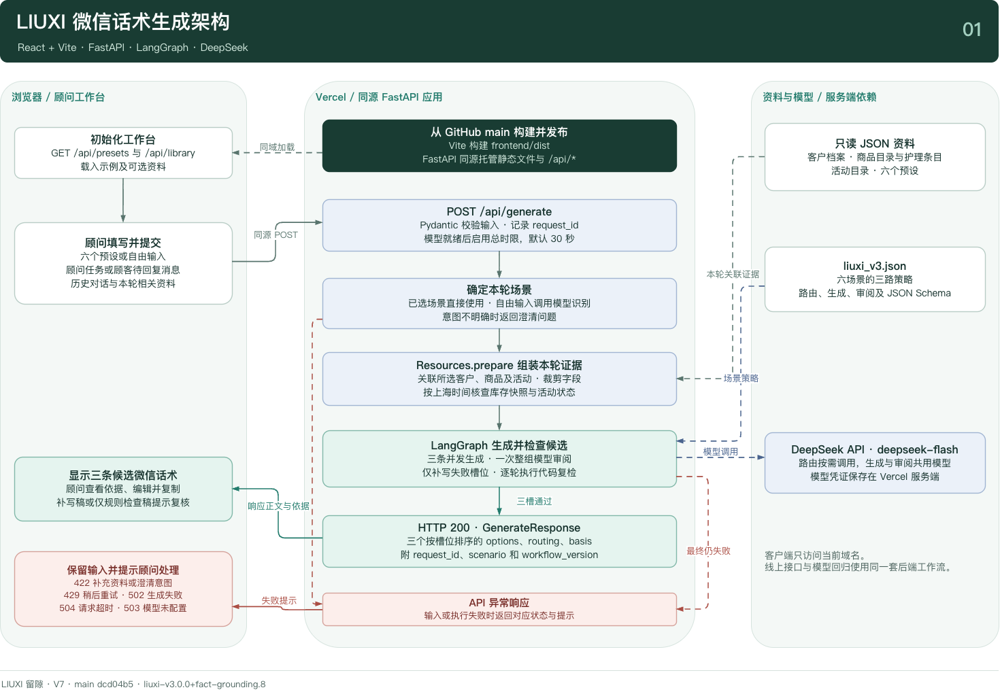

# 留隙 LIUXI · AI 回复工作台

留隙是一款面向奢侈品零售顾问的中文微信回复助手。顾问提供本轮客户消息或沟通目标，工作台结合对话历史、商品目录、护理手册和活动规则，生成三条采用不同沟通策略的草稿，供顾问核对、编辑和复制。品牌、客户和业务资料均为虚构演示数据。

**[打开 Vercel 在线演示 · liuxi.vercel.app](https://liuxi.vercel.app/)**

## 一分钟体验

1. 打开演示，沿用默认的 **PO-02 价格异议**预设。也可以切换到其他预设，或用自由输入体验自动场景识别。
2. 点击 **生成 3 条回复**。对照生成依据，比较各条如何说明目录价、处理未确认的折扣，以及提出不同的后续动作。
3. 选一条草稿，编辑后复制正文。顾问在微信中完成发送。

| 场景 | 工作台处理的典型问题 |
| --- | --- |
| 生日与节日祝福 | 按发送时点和已知聊天细节写个性化问候 |
| 商品推荐 | 根据用途、尺寸和偏好说明选款及待核实项 |
| 购后护理 | 按材质和具体情况给出护理操作与停手条件 |
| 老客唤醒 | 按既有关系和沟通目标拟写低打扰问候 |
| 活动邀约 | 核对场次、报名截止、邀请资格和携伴规则 |
| 价格异议 | 区分目录价、客户预算与已确认的报价权限 |

## 技术实现

Vercel 构建 React、TypeScript 和 Vite 前端，由 FastAPI 在同一个域名下提供页面和 `/api/*`。后端将本轮相关的只读 JSON 资料整理为上下文，使用 LangGraph 编排 DeepSeek 生成流程。模型密钥保存在服务端。

LangGraph 按场景并行生成三条候选，结合代码规则与整组模型审阅检查事实、必答点和策略重复。工作流保留已通过的候选，只补写失败的候选，复检通过后返回整组结果。



[LangGraph 生成与补写流程图](docs/architecture/LIUXI_V7_LangGraph.png) · [可编辑架构源文件](docs/architecture/LIUXI_V7_Model_Workflow.drawio) · [工作流代码](backend/workflow.py) · [UI/UX 设计稿](docs/design/LIUXI_AI_Reply_UI_UX_Design.pdf)

## V7 离线评测

用同一套 50 条用例覆盖六个场景。交付率统计系统是否返回三条完整草稿，合格率按最终正文逐案评阅，每条都需回答关键问题、遵守业务边界，整组还需提供有意义的策略选择。

| 指标 | V7 结果 |
| --- | ---: |
| 三条交付率 | 100%（50/50） |
| 整组合格率 | 80%（40/50） |

[50 条测试用例](evaluation/LIUXI_Test_Cases.xlsx) · [V7 原始输出与逐案评阅](evaluation/LIUXI_50条测试结果_V7.xlsx) · [评测规则与历次存档](evaluation/README.md)

## 本地运行

在仓库根目录执行以下命令。需安装 Docker 和 Docker Compose，并将 DeepSeek API Key 填入本地 `.env` 的 `LLM_API_KEY`。

```bash
cp .env.example .env
# 编辑 .env，填入 LLM_API_KEY
docker compose up --build
```

打开 [localhost:5173](http://localhost:5173/)。本地工作台通过 Vite 代理调用 FastAPI，生产部署由 [vercel.json](vercel.json) 配置。
